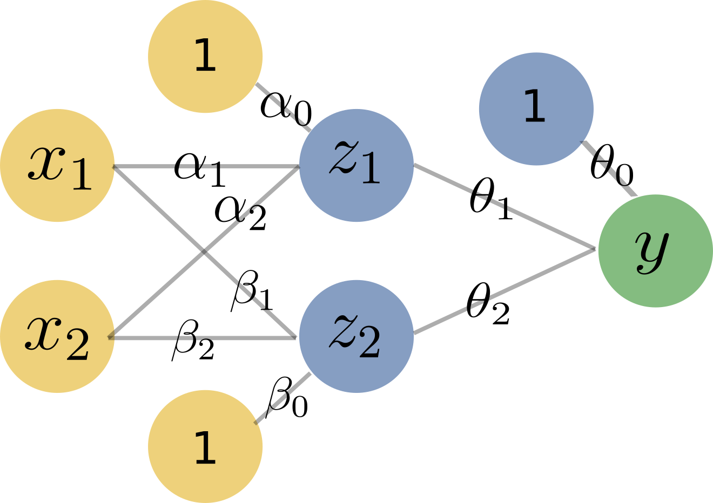

::: {.content-hidden when-format="pdf"}
::: {.hidden}

:::

:::

## Exercise 1: Logistic regression or deep learning?

::: {.callout-note title="Learning goals" icon=false}
1) Understand how stacking single neurons can solve a non-linear classification problem
2) Translate between functional & graph description of NNs
:::

```{r, echo=FALSE, eval=TRUE, message=FALSE, warning=FALSE}
library(ggplot2)
make_plot = function(dt) {
  ggplot(dt, aes(x, y, col = class, shape = class)) +
  geom_point() +
  geom_text(aes(label = label), nudge_y = 0.25, show.legend = FALSE) +
  labs(x = expression(x[1]), y = expression(x[2])) +
  theme_bw()
}

make_plot_sol = function(dt, nudge_x = 0) {
  ggplot(dt, aes(x, y, col = class, shape = class)) +
  geom_point() +
  geom_text(
    aes(label = label), nudge_y = 0.25, nudge_x = nudge_x, show.legend = FALSE
  ) +
  labs(x = expression(x[1]), y = expression(x[2])) +
  theme_bw()
}
```

Suppose you have a set of five training points from two classes. Consider a logistic regression model $\fx = \sigma\left(\bm{\alpha}^\top \xv \right) = \sigma(\alpha_0 + \alpha_1 x_1 + \alpha_2 x_2)$, with $\sigma(\cdot)$ the logistic/sigmoid function, $\sigma(c) = \frac{1}{1 + \exp(-c)}$.

a) Which values for $\bm{\alpha} = (\alpha_0, \alpha_1, \alpha_2)^\top$ would result in correct classification for the problem in @fig-figure1 (assuming a threshold of 0.5 for the positive class)? 

   Don't use any statistical estimation to answer this question -- think in geometrical terms: you need a linear hyperplane that represents a suitable decision boundary.

::: {.indent-1}
```{r, echo=FALSE, eval=TRUE, message=FALSE, warning=FALSE, fig.align="center", fig.height=2, fig.width=3}
#| label: fig-figure1
#| fig-cap: "Classification problem I"
#| fig-pos: "H"

x = c(0, 1, 0, -1, 0)
y = c(0, 0, -1, 0, 1)
data_1 = data.frame(
  x = x,
  y = y,
  class = as.factor(c(rep(0, 3), rep(1, 2))),
  label = sprintf("x%i", 1:5)
)
make_plot(data_1)
```
:::

::: {.content-visible when-profile="solution"}
::: {.indent-1-sol}
<details> 
<summary>**Solution**</summary>

We need to find a linear hyperplane -- i.e.,  a line in 2D -- that separates our classes. There are infinitely many such lines, but the sketch suggests that the line with intercept 0.5 and slope 1 has maximal "safety margin": it has the broadest corridor in which we could move the line without incurring a misclassification error (indicated by dotted lines). Intuitively, this leads to better generalization than any line with a smaller such margin (the mathematical reasoning is treated in support vector machines $\rightsquigarrow$ supervised learning lecture).

Now, we need to translate this into logistic regression coefficients. Note
that we chose the line purely geometrically; the threshold plays no role in
this choice. It only enters when we translate the line into coefficients:
for threshold $c$, the chosen line must be the level set on which the
predicted score equals $c$, i.e.,

$$
\alpha_0 + \alpha_1 x_1 + \alpha_2 x_2 = - \log(\tfrac{1}{c} - 1) ~
\Longleftrightarrow  ~
\alpha_0 + \alpha_1 x_1 + \alpha_2 x_2 = 0 ~~ \text{ for } c = 0.5,
$$ {#eq-hyperplane}

where $c \in [0, 1]$ is the classification threshold.

```{r, echo=FALSE, eval=TRUE, message=FALSE, warning=FALSE, fig.align="center", fig.height=2, fig.width=3}
#| fig-pos: "H"
x = c(0, 1, 0, -1, 0)
y = c(0, 0, -1, 0, 1)
data_1 = data.frame(
  x = x,
  y = y,
  class = as.factor(c(rep(0, 3), rep(1, 2))),
  label = sprintf("x%i", 1:5)
)
make_plot(data_1) +
  geom_abline(intercept = 0.5, slope = 1) +
  geom_abline(intercept = 0, slope = 1, linetype = 3) +
  geom_abline(intercept = 1, slope = 1, linetype = 3)
```

::: {.panel-tabset}
### Quick solution
Logistic regression is not the focus of this exercise, so TL;DR: pick values (not unique) for which points on the line fulfill @eq-hyperplane. For example: $\bm{\alpha}^\prime = (-0.5, -1, 1)^\top$.

### Detailed solution
@eq-hyperplane has 3 unknown quantities -- using a system of linear equations, derived from points we know our line must cross, 3 equations should suffice if there is a unique solution. It turns out that the solution for the linear hyperplane in logistic regression is *not* necessarily unique: multiplying the coefficients in @eq-hyperplane with a constant leaves the equality unchanged.

In ERM, we have additional constraints that usually allow us to find an optimal parameter vector: larger $\bm{\alpha}$ driving the loss down for correctly classified observations is offset by driving it up for misclassified ones.

However, in this special case of linear separability, where a linear classifier produces no misclassification, there is no such optimum (or rather, it is loss-optimal to push the parameter vector to infinity). We will therefore, in this highly unrealistic and simplistic example, use two points the line crosses (which is enough to define any line) and just choose some value for $\bm{\alpha}$ that fulfills @eq-hyperplane.

Let's pick the points $(0, 0.5)^\top$ and $(-0.5, 0)^\top$ (0's are always convenient):

$$
\alpha_0 + \alpha_1 \cdot 0 + \alpha_2 \cdot 0.5 = 0
$$ {#eq-two}

$$
\alpha_0 - \alpha_1 \cdot 0.5 + \alpha_2 \cdot 0 = 0
$$ {#eq-three}

@eq-two - @eq-three yields

$$
\alpha_1 \cdot 0.5 + \alpha_2 \cdot 0.5 = 0 ~ \Leftrightarrow ~ 
\alpha_1 = - \alpha_2,
$$ {#eq-four}

so set, e.g., $\alpha_1^\prime = -1$ and $\alpha_2^\prime = 1$. Plugging this back into either @eq-two or @eq-three yields $\alpha_0^\prime = -0.5$, such that $\bm{\alpha}^\prime = (-0.5, -1, 1)^\top$, and we get the following 
probabilistic scores:

| $i$ | $\yi$ | $\sigma(\alpha_0^\prime + \alpha_1^\prime x_1^{(i)} + \alpha_2^\prime x_2^{(i)})$ |
| --- | ----- | --------------------------------------------------------------------------------- |
| 1   | 0     | 0.38                                                                              |
| 2   | 0     | 0.18                                                                              |
| 3   | 0     | 0.18                                                                              |
| 4   | 1     | 0.62                                                                              |
| 5   | 1     | 0.62                                                                              |

(You can easily verify that a multiple $a \cdot \bm{\alpha}^\prime$ of $\bm{\alpha}^\prime$ leads to the same class assignments, with probabilities closer to 0/1 if $a > 1$.)

:::
</details> 
:::
:::

b) Apply the same principle to find the parameters $\bm{\beta} = (\beta_0, \beta_1, \beta_2)^\top$ for the modified problem in @fig-figure2.

::: {.indent-1}
```{r, echo=FALSE, eval=TRUE, message=FALSE, warning=FALSE, fig.align="center", fig.height=2, fig.width=3}
#| label: fig-figure2
#| fig-cap: "Classification problem II"
#| fig-pos: "H"
data_2 = data_1
data_2$class = as.factor(c(0, rep(1, 2), rep(0, 2)))
make_plot(data_2)
```
:::

::: {.content-visible when-profile="solution"}
::: {.indent-1-sol}
<details> 
<summary>**Solution**</summary>

By the same principle as above, we can derive a possible solution $\bm{\beta}^\prime = (-0.5, 1, -1)^\top$.
  
```{r, echo=FALSE, eval=TRUE, message=FALSE, warning=FALSE, fig.align="center", fig.height=2, fig.width=3}
#| fig-pos: "H"
data_2 = data_1
data_2$class = as.factor(c(0, rep(1, 2), rep(0, 2)))
make_plot(data_2) +
  geom_abline(intercept = -0.5, slope = 1) +
  geom_abline(intercept = 0, slope = 1, linetype = 3) +
  geom_abline(intercept = -1, slope = 1, linetype = 3)
```

| $i$ | $\yi$ | $\sigma(\beta_0^\prime + \beta_1^\prime x_1^{(i)} + \beta_2^\prime x_2^{(i)})$ |
| --- | ----- | ------------------------------------------------------------------------------ |
| 1   | 0     | 0.38                                                                           |
| 2   | 1     | 0.62                                                                           |
| 3   | 1     | 0.62                                                                           |
| 4   | 0     | 0.18                                                                           |
| 5   | 0     | 0.18                                                                           |

</details> 
:::
:::

c) Now consider the problem in @fig-figure3, which is not linearly separable anymore, so logistic regression will not help us any longer. Suppose we had alternative coordinates $\left(z_1, z_2\right)^\top$ for our data points:

::: {.indent-1}
| $i$ | $z_1^{(i)}$ | $z_2^{(i)}$ | $\yi$ |
| --- | ----------- | ----------- | ----- |
| 1   | 0           | 0           | 1     |
| 2   | 0           | 1           | 0     |
| 3   | 0           | 1           | 0     |
| 4   | 1           | 0           | 0     |
| 5   | 1           | 0           | 0     |

```{r, echo=FALSE, eval=TRUE, message=FALSE, warning=FALSE, fig.align="center", fig.height=2, fig.width=3}
#| label: fig-figure3
#| fig-cap: "Classification problem III"
#| fig-pos: "H"
data_3 = data_1
data_3$class = as.factor(c(1, rep(0, 4)))
make_plot(data_3)
```

Explain how we can use $z_1$ and $z_2$ to classify the dataset in @fig-figure3.

<details>
<summary>*Hint*</summary>

Sketch the five observations in a scatterplot with the new coordinates $(z_1, z_2)^\top$ as axes. Does the picture remind you of the problems in a) and b)?

</details>
:::

::: {.content-visible when-profile="solution"}
::: {.indent-1-sol}
<details> 
<summary>**Solution**</summary>

Intuitively, we can see that a condition like $z_1 + z_2 > 0$ suffices to separate $\xi[1]$ from the other observations, which should remind you of the equation for a linear hyperplane.

Graphically, we can visualize our points in the new $z_1, z_2$ coordinates and see that this transformed dataset is indeed linearly separable:
  
```{r, echo=FALSE, eval=TRUE, message=FALSE, warning=FALSE, fig.align="center", fig.height=2, fig.width=3}
#| fig-pos: "H"
data_3 = data.frame(
  x = c(0, 0, 1),
  y = c(0, 1, 0),
  class = as.factor(c(1, 0, 0)),
  label = c("x1", "x2 = x3", "x4 = x5")
)
make_plot(data_3) +
  xlim(c(-0.5, 1.5)) +
  ylim(c(-0.5, 1.5)) +
  geom_abline(intercept = 0.5, slope = -1) +
  labs(x = expression(z[1]), y = expression(z[2]))
```

</details> 
:::
:::

d) The question is now, of course, how we can get these $z_1$ and $z_2$ that provide a solution to our previously unsolved problem -- naturally, from the data.

   The idea: predict $z_1$ and $z_2$ from the original features with two separate logistic regression models,
   $$\hat z_1 = \sigma(\gamma_0 + \gamma_1 x_1 + \gamma_2 x_2), \qquad \hat z_2 = \sigma(\phi_0 + \phi_1 x_1 + \phi_2 x_2),$$
   treating the $z$-columns of the table above as target labels. Find suitable parameter vectors $\bm{\gamma}, \bm{\phi} \in \R^3$ in the same way as in a) and b), i.e., by looking for hyperplanes that separate the observations with $z_j = 0$ from those with $z_j = 1$.

::: {.content-visible when-profile="solution"}
::: {.indent-1-sol}
<details> 
<summary>**Solution**</summary>

Looking at $z_1$, we find that it serves to separate observations $\{1, 2, 3\}$ from $\{4, 5\}$. Likewise, $z_2$ separates $\{1, 4, 5\}$ from $\{2, 3\}$. Predicting $z_1$ thus corresponds to classification problem I, and $z_2$ to classification problem II, so we can use our previous solutions $\bm{\gamma} = \bm{\alpha}^\prime = (-0.5, -1, 1)^\top$ and $\bm{\phi} = \bm{\beta}^\prime = (-0.5, 1, -1)^\top$.
  
</details> 
:::
:::

e) Lastly, put together your previous results to formulate a model that predicts the original target $y$ from the original features $\left(x_1, x_2\right)^\top$: feed the outputs of the two models from d) into a third logistic regression model. Choose concrete values for all parameters such that all five observations are classified correctly (again with threshold 0.5).

   <details>
   <summary>*Hint*</summary>

   The models from d) output values strictly between 0 and 1 rather than exact 0/1 labels. Multiplying a parameter vector by a constant $a > 1$ leaves the decision boundary of the corresponding model unchanged, but pushes its predicted probabilities toward 0 and 1.

   </details>

::: {.content-visible when-profile="solution"}
::: {.indent-1-sol}
<details> 
<summary>**Solution**</summary>

We can simply stack the logistic regression components as follows:

\begin{align*}
  \yh &= \sigma\left( \theta_0 + \theta_1 z_1 + \theta_2 z_2\right) \\
  &= \sigma\left( \theta_0 + \theta_1 \cdot \sigma\left(\alpha_0 + \alpha_1 
  x_1 + \alpha_2 x_2\right) + \theta_2 \cdot \sigma\left(\beta_0 + \beta_1 x_1 
  + \beta_2 x_2\right)
  \right)
\end{align*}

For $\thetav$, we can once more proceed geometrically: in the $z$-coordinates from c), the line $z_1 + z_2 = 0.5$ separates observation 1 from the others, yielding, e.g., $\thetav^\prime = (0.5, -1, -1)^\top$.

If we plug $\bm{\alpha}^\prime$ and $\bm{\beta}^\prime$ from a) and b) into the stacked model directly, however, the inner models output values like 0.38 and 0.62 instead of (nearly) binary ones, and you can check that $\yh$ then stays below 0.5 for *all* five observations. This is where the hint comes in: scaling the first-layer parameters sharpens the inner sigmoids without moving their decision boundaries. Using, e.g., $10 \cdot \bm{\alpha}^\prime$ and $10 \cdot \bm{\beta}^\prime$, the inner outputs lie close to 0 or 1 (e.g., $\sigma(-5) \approx 0.01$), and we obtain

- $\yh \approx \sigma(0.5 - 2 \cdot 0.01) \approx 0.62 > 0.5$ for observation 1 and
- $\yh \approx \sigma(0.5 - 0.01 - 0.99) \approx 0.38 < 0.5$ for observations 2 to 5,

so all five observations are classified correctly. Our final hand-picked model is thus

$$
\yh = \sigma\big(0.5 - \sigma(-5 - 10 x_1 + 10 x_2) - \sigma(-5 + 10 x_1 - 10 x_2)\big).
$$

In practice, we will of course use ERM to estimate, rather than hand-pick, $\bm{\alpha}, \bm{\beta}, \bm{\theta}$.
</details> 
:::
:::

```{=latex}
\needspace{8\baselineskip}
```

f) The model you built in e) is, in fact, a neural network. Sketch it!

   <details>
   <summary>*Hint*</summary>

   Draw the biases as additional neurons with constant value 1. Label the edges with the Greek-letter parameters from the previous subtasks; no need for the concrete numbers from e).

   </details>

::: {.content-visible when-profile="solution"}
::: {.indent-1-sol}
<details> 
<summary>**Solution**</summary>

We created a feedforward neural network with two input neurons, two hidden neurons (each performing one intermediate logistic regression), and one output neuron. The biases are depicted as 1-neurons:

{width=40%}
</details> 
:::
:::

## Exercise 2: When to use deep learning?

::: {.callout-note title="Learning goals" icon=false}
1) Judge which problems call for deep learning and which are better solved
with classic ML methods
2) Argue with data type, dimensionality, data volume, and practical
constraints
:::

For each of the following scenarios, decide whether you would reach for a
deep learning approach or a classic ML method (e.g., penalized logistic
regression, CART, random forest). Justify your answer.

a) A hospital wants to predict the risk of diabetes from 25 clinical
measurements (blood values, age, BMI, ...) of 800 patients. The physicians
need to understand which factors drive the prediction.

::: {.content-visible when-profile="solution"}
::: {.indent-1-sol}
<details>
<summary>**Solution**</summary>

Classic ML is clearly preferable here:

- The data are *tabular*, with few, individually informative features, which
is exactly the setting where models like penalized regression or
tree-based ensembles are strong.
- 800 observations are far too few to train a deep network without severe
overfitting.
- Interpretability is required: a (penalized) logistic regression or a
shallow tree directly shows the influence of each clinical measurement,
whereas a neural network is hard to interpret.

</details>
:::
:::

b) An online retailer wants to sort product photos into 50 categories and has
collected 2 million labeled images.

::: {.content-visible when-profile="solution"}
::: {.indent-1-sol}
<details>
<summary>**Solution**</summary>

This is a prime use case for deep learning:

- Image data are *high-dimensional* (every pixel is a feature), and a single
pixel carries almost no information; only complex combinations of pixels
do. Neural networks learn such feature representations automatically,
while classic ML would require extensive manual feature engineering.
- With 2 million labeled images, there is enough training data to fit a
deep architecture.
- Specialized network architectures for image data exist that exploit the
spatial structure of the input.

</details>
:::
:::

c) An insurance company wants to predict claim probabilities from a tabular
dataset with 100,000 rows and a mix of numeric and categorical features.
The team has little time for model tuning.

::: {.content-visible when-profile="solution"}
::: {.indent-1-sol}
<details>
<summary>**Solution**</summary>

Classic ML is the more sensible default:

- For tabular data, models like random forests or gradient boosting often
outperform deep learning unless the latter is tuned extensively, which
conflicts with the limited tuning budget.
- Deep learning *can* pay off for tabular data, e.g., with categorical
features of many levels or complex feature interactions, but it comes
with technical challenges (overfitting, hyperparameter sensitivity,
interpretability).

</details>
:::
:::

d) A streaming service wants to classify millions of free-text customer
reviews as positive or negative.

::: {.content-visible when-profile="solution"}
::: {.indent-1-sol}
<details>
<summary>**Solution**</summary>

Deep learning is the method of choice:

- Text is high-dimensional (each word can be a feature), and a single word
provides little context on its own; informative signals lie in
combinations of words. Again, neural networks can learn suitable
representations themselves.
- Millions of reviews provide ample training data, and specialized
architectures for text data exist.

</details>
:::
:::

::: {.content-hidden when-profile="a"}

## Exercise 3: Forward pass by hand

::: {.callout-tip icon=false title="The whole exercise is only for lecture group B!"}
:::

::: {.callout-note title="Learning goals" icon=false}
1. Count the parameters of a neural network
2. Compute a forward pass through a small MLP
3. Understand the effect of the ReLU activation
:::

Consider a feedforward neural network for binary classification with two
input features $x_1, x_2$, one hidden layer containing two neurons $z_1, z_2$
with ReLU activation, $\text{ReLU}(v) = \max(0, v)$, and a sigmoid output
neuron:

\begin{align*}
  z_1 &= \text{ReLU}(w_{11} x_1 + w_{21} x_2 + b_1), \\
  z_2 &= \text{ReLU}(w_{12} x_1 + w_{22} x_2 + b_2), \\
  \yh &= \sigma(u_1 z_1 + u_2 z_2 + c).
\end{align*}

The weights and biases have already been trained:

| $w_{11}$ | $w_{21}$ | $b_1$ | $w_{12}$ | $w_{22}$ | $b_2$ | $u_1$ | $u_2$ | $c$ |
| -------: | -------: | ----: | -------: | -------: | ----: | ----: | ----: | --: |
| 1        | $-1$     | 0     | 1        | 1        | $-1$  | 2     | $-1$  | $-1$ |

a) How many parameters (weights and biases) does this network have? How does
this number change if we use a hidden layer with 10 neurons instead of 2?

::: {.content-visible when-profile="solution"}
::: {.indent-1-sol}
<details>
<summary>**Solution**</summary>

Each hidden neuron has 2 weights (one per input) and 1 bias, and the output
neuron has 1 weight per hidden neuron plus 1 bias. For $m$ hidden neurons,
this amounts to $(2 + 1) \cdot m + (m + 1)$ parameters:

- $m = 2$: $3 \cdot 2 + 3 = 9$ parameters (matching the table above).
- $m = 10$: $3 \cdot 10 + 11 = 41$ parameters.

</details>
:::
:::

b) Compute the forward pass for the two observations
$\xv^{(a)} = (1, 0)^\top$ and $\xv^{(b)} = (-1, 2)^\top$: state the hidden
activations $z_1, z_2$, the predicted probability $\yh$, and the predicted
class for a threshold of 0.5. You may use $\sigma(1) \approx 0.73$ and
$\sigma(-1) \approx 0.27$.

::: {.content-visible when-profile="solution"}
::: {.indent-1-sol}
<details>
<summary>**Solution**</summary>

For $\xv^{(a)} = (1, 0)^\top$:

- $z_1 = \text{ReLU}(1 \cdot 1 + (-1) \cdot 0 + 0) = \text{ReLU}(1) = 1$
- $z_2 = \text{ReLU}(1 \cdot 1 + 1 \cdot 0 - 1) = \text{ReLU}(0) = 0$
- $\yh = \sigma(2 \cdot 1 + (-1) \cdot 0 - 1) = \sigma(1) \approx 0.73$

As $\yh > 0.5$, we predict class 1. (You can also see this without knowing
the value of $\sigma(1)$: the sigmoid exceeds 0.5 exactly for positive
inputs.)

For $\xv^{(b)} = (-1, 2)^\top$:

- $z_1 = \text{ReLU}(1 \cdot (-1) + (-1) \cdot 2 + 0) = \text{ReLU}(-3) = 0$
- $z_2 = \text{ReLU}(1 \cdot (-1) + 1 \cdot 2 - 1) = \text{ReLU}(0) = 0$
- $\yh = \sigma(2 \cdot 0 + (-1) \cdot 0 - 1) = \sigma(-1) \approx 0.27$

As $\yh < 0.5$, we predict class 0.

</details>
:::
:::

c) Look closely at your result for $\xv^{(b)}$: on which parts of the network
does its prediction actually depend? Explain what would change if the hidden
neurons used the sigmoid instead of the ReLU activation.

::: {.content-visible when-profile="solution"}
::: {.indent-1-sol}
<details>
<summary>**Solution**</summary>

For $\xv^{(b)}$, both hidden neurons are *inactive*: the ReLU cuts their
negative (resp. zero) pre-activations to 0. The prediction
$\yh = \sigma(c)$ thus depends only on the output bias $c$, and no
information about the features reaches the output.
This is a general property of the ReLU: neurons can switch off completely
for parts of the input space.

With sigmoid activation, the hidden neurons would output
$\sigma(-3) \approx 0.05$ and $\sigma(0) = 0.5$ instead of exact zeros:
every neuron always passes on *some* signal, and the prediction would again
depend on the inputs.

</details>
:::
:::

:::

::: {.content-hidden when-profile="b"}

```{=latex}
\needspace{14\baselineskip}
```

## Exercise 4: Modifying the network

::: {.callout-tip icon=false title="The whole exercise is only for lecture group A!"}
:::

::: {.callout-note title="Learning goals" icon=false}
1. Extend a binary NN architecture to multi-class prediction
2. Understand why nonlinear activation functions are essential
3. Solve "show that..."-type exercises
:::

In Exercise 1, we built a network for binary classification: two sigmoid
neurons compute hidden activations $\hat z_1$ and $\hat z_2$ from the inputs
$x_1, x_2$, and a sigmoid output neuron predicts $y$ from
$\hat z_1, \hat z_2$, where each neuron has one weight per input plus a bias.
Suppose now our five observations belong to one of $g = 3$ classes.

a) Explain how this network needs to be modified to handle
the multi-class problem: how many output neurons do we need, which activation
do we apply to them, and how do we obtain class predictions? Also state the
number of parameters of the modified network.

::: {.content-visible when-profile="solution"}
::: {.indent-1-sol}
<details>
<summary>**Solution**</summary>

Instead of a single sigmoid output neuron, we use $g = 3$ output neurons,
one per class, computing scores
$f_k = \theta_{k0} + \theta_{k1} z_1 + \theta_{k2} z_2$ for
$k \in \{1, 2, 3\}$. To turn the score vector
$\bm{f} = (f_1, f_2, f_3)^\top$ into class probabilities, we apply the
*softmax* function

$$
\pi_k = \frac{\exp(f_k)}{\sum_{j = 1}^g \exp(f_j)},
$$

which generalizes the sigmoid: all $\pi_k$ are positive and sum to 1 (recall
from exercise sheet 3 that softmax regression with $g = 2$ is equivalent to
logistic regression). The
predicted class is the one with the highest probability (which, since
softmax is monotone in the scores, is also the class with the highest
score).

Parameter count: the hidden layer is unchanged with
$2 \cdot 3 = 6$ parameters ($\bm{\alpha}, \bm{\beta}$), and each of the 3
output neurons has 2 weights and 1 bias, so $3 \cdot 3 = 9$ output
parameters, for a total of $15$ (compared to 9 in the binary network).

</details>
:::
:::

b) Back to the binary network: suppose we drop the sigmoid activations in the
hidden neurons, so that the hidden layer passes on the linear scores
$\tilde z_1 = \gamma_0 + \gamma_1 x_1 + \gamma_2 x_2$ and
$\tilde z_2 = \phi_0 + \phi_1 x_1 + \phi_2 x_2$ directly. Show that the
network then collapses to an ordinary logistic regression model on
$(x_1, x_2)^\top$. Using Exercise 1 c), argue why this network cannot
classify all five observations correctly, and conclude what role the
activation functions play.

::: {.content-visible when-profile="solution"}
::: {.indent-1-sol}
<details>
<summary>**Solution**</summary>

We plug the linear scores into the output neuron and collect terms:

\begin{align*}
\yh &= \sigma\left(\theta_0 + \theta_1 \tilde z_1 + \theta_2 \tilde z_2\right) \\
&= \sigma\big(\theta_0 + \theta_1 (\gamma_0 + \gamma_1 x_1 + \gamma_2 x_2)
+ \theta_2 (\phi_0 + \phi_1 x_1 + \phi_2 x_2)\big) \\
&= \sigma\big(\underbrace{(\theta_0 + \theta_1 \gamma_0 + \theta_2 \phi_0)}_{=: \tilde\theta_0}
+ \underbrace{(\theta_1 \gamma_1 + \theta_2 \phi_1)}_{=: \tilde\theta_1} x_1
+ \underbrace{(\theta_1 \gamma_2 + \theta_2 \phi_2)}_{=: \tilde\theta_2} x_2\big) \\
&= \sigma\left(\tilde\theta_0 + \tilde\theta_1 x_1 + \tilde\theta_2 x_2\right).
\end{align*}

This is exactly a logistic regression model on the original features: no
matter how we choose the parameters, the hidden layer adds no expressive
power. From Exercise 1 c), we know that classification problem III is *not*
linearly separable, so no logistic regression model -- and hence no network
with identity activations -- can classify all five observations correctly,
whereas the network with sigmoid activations can.

The nonlinear activations are therefore not a technical detail but the very
reason hidden layers help: they allow the network to learn nonlinear
decision boundaries. This argument extends to deep networks in general
(stacking any number of linear layers yields just another linear model).

</details>
:::
:::

:::
